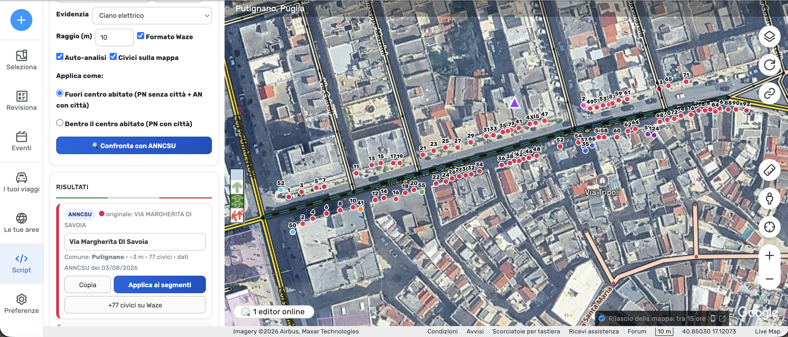
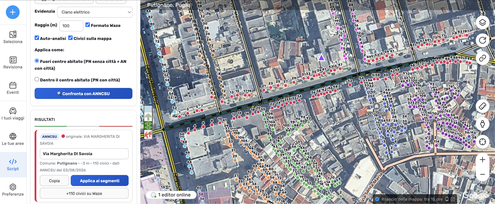

# WME Fonti Stradali IT

Userscript per il **Waze Map Editor** che confronta i segmenti selezionati con i civici e gli odonimi
ufficiali **ANNCSU** (Archivio Nazionale dei Numeri Civici e delle Strade Urbane – Istat / Agenzia
delle Entrate): evidenzia i segmenti in lista, mostra i civici sulla mappa, compila nome via/contrada,
località, comune e inserisce i numeri civici (esponente compreso, nel formato `343/A`, `12/BIS`).

Nomi e civici seguono le guide della [**Wazeopedia Italia**](https://www.waze.com/discuss/c/wazeopedia/italy-wazeopedia/5205)
(Denominazione delle strade, Numeri civici, Centro abitato & City Boundary) e lo script usa **solo
l'SDK ufficiale del WME**.

Creato da **checcoconf** · dati: ANNCSU, open data con licenza [CC-BY 4.0](https://creativecommons.org/licenses/by/4.0/deed.it).

> **Lo script non sostituisce il lavoro dell'editor: lo facilita.** Ogni modifica va verificata con i
> cartelli stradali, i civici reali, la conoscenza del territorio e buon senso. Lo strumento propone,
> la responsabilità di ciò che finisce sulla mappa resta di chi salva.

---

## Indice

1. [Installazione](#1--installazione)
2. [Accessi e abilitazione](#2--accessi-e-abilitazione)
3. [Flusso di lavoro in breve](#3--flusso-di-lavoro-in-breve)
4. [Dati ANNCSU](#4--dati-anncsu)
5. [Segmenti (cattura)](#5--segmenti-cattura)
6. [Il Raggio](#6--il-raggio)
7. [Confronta con ANNCSU](#7--confronta-con-anncsu)
8. [Applica i nomi ai segmenti](#8--applica-i-nomi-ai-segmenti)
9. [Inserimento dei numeri civici](#9--inserimento-dei-numeri-civici)

In fondo: [Se qualcosa non funziona](#se-qualcosa-non-funziona) · [Errori e cosa fare](#errori-e-cosa-fare) · [Note per gli editor](#note-per-gli-editor) · [Licenza](#licenza)

---

## 1 · Installazione

1. Installa [Tampermonkey](https://www.tampermonkey.net/).
2. Clicca qui: **[Installa / Aggiorna lo script](https://github.com/checcoconf/wme-fonti-stradali-it/releases/latest/download/wme-fonti-stradali-it.user.js)**
3. Ricarica il Waze Map Editor: il pannello compare nella scheda **Script** della barra laterale.

Gli aggiornamenti arrivano da soli: Tampermonkey controlla l'ultima release pubblicata. In caso di
dubbio: *Tampermonkey → Utility → Controlla aggiornamenti degli userscript*.

**Avvisi di aggiornamento.** Dalla 1.0.0 lo script controlla da sé l'ultima release a ogni avvio
(e ogni 6 ore se l'editor resta aperto). Quando ne esce una nuova:

- nella **campanella** del WME compare la notifica con il bottone **Aggiorna**, che apre
  l'installazione in Tampermonkey;
- accanto al numero di versione, nel pannello, compare il bottone verde **Aggiorna a vX**.

Dopo l'installazione ricarica l'editor (F5). Nella campanella trovi poi le **novità** della versione;
si riaprono anche cliccando il numero di versione nel pannello. Gli avvisi passano da
[WME Alert System](https://greasyfork.org/scripts/602363), la libreria condivisa con altri script
WME: le notifiche non si accavallano e WME e WME beta le condividono.

**Nuovi dati ANNCSU.** Una volta al giorno lo script guarda se ANNCSU ha pubblicato un dataset più
recente per le regioni che hai già in locale. Non scarica i dati: legge solo la data nel nome del file
pubblicato (pochi byte). Se una regione è più vecchia, nella campanella arriva la notifica con il
bottone **Aggiorna**, che riscarica solo quelle regioni, e il pulsante *Aggiorna* del pannello si
accende di verde. Il download parte solo quando premi tu.

**Requisiti**

| Requisito | Dettaglio |
|---|---|
| Editor | `waze.com/editor` o `beta.waze.com/editor` (SDK WME) |
| Gestore userscript | Tampermonkey (serve `GM_xmlhttpRequest` per scaricare i dataset) |
| Spazio locale | IndexedDB: circa **16 byte per civico**, una regione grande occupa poche decine di MB |
| Abilitazione | l'utente Waze deve essere nell'elenco degli abilitati (vedi sotto) |

---

## 2 · Accessi e abilitazione

Lo script è **riservato agli editor abilitati**. La verifica avviene all'avvio, prima che venga
attivata qualunque funzione: finché non arriva l'OK non si cattura nulla, non si scaricano dati e non
si disegna niente sulla mappa.

**Come funziona il controllo**

1. Alla partenza lo script legge il tuo **nome utente Waze** (dall'SDK, in mancanza dal modello legacy).
2. Interroga il foglio Google degli abilitati tramite un Web App Apps Script, inviando nome utente,
   livello e un identificativo di sessione (l'SDK del WME non espone più l'id numerico dell'utente).
3. Se sei in elenco, il pannello si apre e tutte le funzioni si attivano.
4. Se non lo sei, il pannello mostra **401 Unauthorized** con il tuo nome utente e il motivo, più il
   pulsante **"Ho ricevuto l'abilitazione: ricontrolla"** per rifare la verifica al volo.

**Tempi e casi limite**

| Situazione | Comportamento |
|---|---|
| Esito positivo | resta valido **2 ore** in cache locale, poi si richiede di nuovo |
| Editor aperto a lungo | ricontrollo automatico ogni **30 minuti** |
| Abilitazione revocata mentre lavori | chiusura immediata: lista svuotata, civici rimossi dalla mappa, pannello 401 |
| Foglio non raggiungibile | se poco prima eri abilitato si continua per un massimo di **72 ore** di tolleranza; in caso di dubbio non si apre |
| Versione minima imposta dallo sviluppatore | se la tua è più vecchia il pannello mostra **"Aggiornamento necessario"** e blocca tutto finché non aggiorni |

**Per farti abilitare** scrivi ai coordinatori della community italiana di Waze. Il link diretto è nel pannello, in fondo e nella schermata 401.

---

## 3 · Flusso di lavoro in breve

1. **Scarica la tua regione** (una volta sola): i civici ANNCSU restano in cache locale.
2. **Imposta il Raggio** in base al contesto (predefinito 10 m: paese ~10 m, fuori centro abitato 20–30 m).
3. **ALT + clic** sui segmenti: si evidenziano sulla mappa ed entrano in lista. Con **Seleziona tutta la
   via** prendi in un colpo tutti i tronconi caricati della stessa strada.
4. **Confronta con ANNCSU**: per ogni odonimo vedi comune, località, distanza, i civici colorati e come
   è scritta la strada su Waze adesso.
5. Controlla il nome proposto (e gli avvisi sotto la casella), scegli la città se ti viene chiesto,
   **Applica ai segmenti** e **salva**.
6. **+N civici su Waze**: elenco di controllo con spunte. Quelli già su Waze, quelli da fare come RPP e
   quelli **da verificare** (formati insoliti come `20/1`) arrivano senza spunta. Controlla con
   **Street View**, poi **Inserisci** e salva di nuovo. Vale anche **fuori centro abitato**: lì si
   inseriscono civici normali come in paese.

---

## 4 · Dati ANNCSU

Sezione **Dati ANNCSU** del pannello.

| Comando | Cosa fa |
|---|---|
| **Scarica regione** | scarica il dataset ANNCSU della regione scelta, lo analizza e lo salva in locale (IndexedDB) |
| **Scarica tutte** | scorre tutte e 20 le regioni una dopo l'altra (alcuni minuti e parecchia memoria: te lo chiede prima di partire) |
| **Aggiorna** | riscarica solo le regioni che hai già in locale |
| **Svuota dati** | cancella tutte le regioni salvate e riparte da zero |

Durante uno scarico multiplo il pulsante diventa **Ferma**: il ciclo si interrompe alla fine della
regione in corso, senza lasciare dati a metà.

**Freschezza dei dati.** ANNCSU aggiorna i dataset regionali con **cadenza mensile**, e in questo
periodo i Comuni stanno completando la georeferenziazione dei civici: un giro ogni **4–6 settimane**
può far comparire strade e numeri prima assenti. Il pannello scrive sempre da quanti giorni hai
scaricato ogni regione e, superati i **35 giorni**, il pulsante *Aggiorna* si accende di verde. È solo
un promemoria: **lo script non riscarica mai da solo**.

**Controlli automatici sulla qualità.** Al termine dell'analisi lo script verifica la colonna
`ESPONENTE`: se più della metà dei civici risulta averne uno, quasi certamente si sta leggendo la
colonna sbagliata (un progressivo, un codice interno) e il pannello ti avvisa in arancione. Stesso
avviso se la cache proviene da una versione precedente dello script, nel qual caso gli esponenti
possono mancare: basta ripremere *Scarica regione* per rigenerarla.

**Elenco comuni.** I codici Belfiore vengono tradotti in nomi di comune con l'elenco ISTAT di
`data/comuni.json`, che Tampermonkey scarica insieme allo script: funziona anche offline.

---

## 5 · Segmenti (cattura)

### Modalità di cattura

Menu **Cattura**:

| Modalità | Come si usa |
|---|---|
| **⌥ ALT + clic** *(predefinita)* | tieni ALT e clicca il segmento |
| **⌥⇧ ALT + MAIUSC + clic** | alternativa se ALT ti serve per altro |
| **⌃/⌘⌥ CTRL + ALT + clic** | idem, su combinazione ancora più libera |
| **⌨ Un tasto a tua scelta + clic** | vedi sotto |
| **Spenta** | nessuna cattura al clic: usi solo *Aggiungi selezione attuale* |

MAIUSC e CTRL **da soli** non sono selezionabili di proposito: il WME li usa per la multi-selezione.
Se l'SDK lo consente, la scorciatoia **A + C** cicla al volo fra le modalità.

**Tasto personalizzato.** Scegli *Un tasto a tua scelta*: compare un riquadro rosso "cliccami per
attivare l'ascolto del tasto". Cliccalo e premi **un solo tasto**; il tasto letto resta in attesa di
conferma (**Conferma** salva, **Rifai** riapre l'ascolto, **ESC** annulla, **Azzera** torna ad ALT).
Resta salvato anche nelle sessioni successive. Mentre lo tieni premuto lo script blocca l'eventuale
scorciatoia WME sullo stesso tasto, ma conviene comunque sceglierne uno poco usato: i tasti singoli
sono la fascia che WME, Toolbox e gli altri script si contendono.

> **Lavora per tratti brevi.** Cattura i segmenti che stai davvero guardando, non tutta la via in un
> colpo: il nome sui cartelli può cambiare da un tratto all'altro, e il confronto con i civici già su
> Waze vale solo su ciò che l'editor ha caricato.

### La lista dei segmenti

I segmenti catturati compaiono come **chip** sotto il menu:

- clic sul chip → lo seleziona nell'editor;
- clic sulla **×** (o ri-clic sul segmento con il modificatore) → lo toglie dalla lista;
- **chip rosso** → su quel segmento l'ultimo *Applica* è fallito;
- **Aggiungi selezione attuale** → mette in lista i segmenti selezionati nell'editor. Comodo dopo una
  multi-selezione;
- **Svuota lista** → azzera tutto (risultati e civici sulla mappa si riallineano da soli).

### Le altre opzioni

| Opzione | Cosa fa |
|---|---|
| **Evidenzia** | colore del tratteggio con cui i segmenti in lista vengono marcati sulla mappa (ciano, fucsia, giallo, lime, arancione) |
| **Raggio (m)** | distanza massima civico–segmento per il confronto → [Il Raggio](#6--il-raggio) |
| **Formato Waze** | scrive il nome con maiuscole e minuscole all'italiana (`VIA MARGHERITA DI SAVOIA` → `Via Margherita di Savoia`). Spegnendola resta il maiuscolo di ANNCSU, ma le altre correzioni (sigle, date, abbreviazioni) valgono comunque |
| **Auto-analisi** | il confronto riparte da solo a ogni modifica della lista |
| **Civici sulla mappa** | disegna i punti ANNCSU etichettati col numero (343, 343/A…), colorati per odonimo |
| **Pallini** | dimensione dei punti e dei numeri disegnati sulla mappa: *Piccoli*, *Normali* (predefinito), *Grandi*, *Molto grandi*, *Enormi*. Comodo su schermi grandi o quando i civici sono fitti; non cambia nulla di ciò che finisce su Waze. Compare solo con *Civici sulla mappa* attivo |
| **Applica come** | regola di scrittura dell'indirizzo → [Applica](#8--applica-i-nomi-ai-segmenti) |

---

## 6 · Il Raggio

Il **Raggio** è la distanza massima, in metri, entro cui un civico ANNCSU viene considerato
"appartenente" ai segmenti che hai in lista. È la variabile che determina la corrispondenza fra
numerazione civica e segmento selezionato: **più il valore tende verso lo zero, più l'accuratezza è
precisa**.

Il campo parte da **10 m** e accetta valori da **1 a 50 m**: oltre i 45 m Waze rifiuta i civici, quindi
un raggio più largo gonfierebbe solo i risultati. Il valore giusto si trova partendo stretti e
allargando poco per volta, non il contrario.

### Come lo usa lo script

Per ogni segmento in lista lo script cerca i civici ANNCSU entro il raggio, misurando la distanza dalla
**linea del segmento** (non dal centro né dai vertici). Li raggruppa per odonimo e tiene una sola volta
il civico agganciato da più tronconi della stessa via. Restano al massimo **8 odonimi**, ordinati per
distanza, ciascuno col suo colore.

### Valori consigliati

| Contesto | Raggio | Perché |
|---|---|---|
| **Strada di paese / centro abitato** | **~10 m** | i segmenti sono corti e le vie parallele sono vicine: un raggio stretto evita di agganciare i civici della via accanto |
| **Fuori dal centro abitato / contrade** | **~20–30 m** | i segmenti sono molto più lunghi, gli edifici arretrati dalla strada e non tutti i civici sono inseriti dall'ente comunale |
| **Ricognizione iniziale** | fino a 50 m | utile solo per capire *quali* odonimi insistono sulla zona, mai per applicare o inserire |

Il valore predefinito è **10 m**: buono per la stragrande maggioranza delle strade di paese e di città.

**Due limiti da tenere a mente**

- **Sotto i ~10 m si rischia di perdere civici legittimi.** I punti ANNCSU stanno sugli edifici e
  sugli ingressi, non sull'asse stradale: spesso sono a 5–20 m dalla mezzeria. Un raggio troppo
  stretto taglia fuori numeri veri, soprattutto dove la carreggiata è larga o c'è un marciapiede
  ampio.
- **Oltre i 45 m i civici non si possono inserire.** Waze li rifiuta, quindi anche col raggio a 50 m
  quelli più lontani restano fuori dall'elenco di inserimento (te lo scrive).

### ✅ Raggio configurato bene

**Situazione civica in una strada di paese — raggio consigliato: ~10 metri**

Il confronto aggancia **77 civici**, tutti effettivamente appartenenti al segmento su cui si sta
lavorando. La numerazione è leggibile, coerente e pronta da applicare.

### ❌ Raggio configurato male

**Stesso segmento, raggio 100 metri**

Il confronto aggancia **110 civici** allo stesso odonimo e riempie la mappa con i punti di tutte le
vie limitrofe: otto odonimi diversi, numerazioni sovrapposte, impossibile capire quale numero
appartiene a quale strada. Applicare o inserire in queste condizioni significa sporcare la mappa.

> **Regola pratica:** parti stretto e allarga solo se mancano civici che vedi sul territorio. Se la
> lista dei risultati contiene odonimi che non c'entrano nulla con il segmento selezionato, il raggio
> è troppo largo.

---

## 7 · Confronta con ANNCSU

Con **Auto-analisi** attiva il confronto parte da solo a ogni cattura; altrimenti premi
**🔍 Confronta con ANNCSU**.

Per ogni odonimo trovato compare una scheda con:

- il **nome originale ANNCSU** (in maiuscolo, come nell'archivio);
- una **casella modificabile** con il nome già pronto per Waze;
- **Comune**, **Località/contrada**, **distanza minima** dal segmento, **numero di civici distinti** e
  la **data del dataset** ANNCSU da cui provengono;
- il **pallino colorato** che corrisponde ai punti disegnati sulla mappa;
- la spunta **✓ nome principale già così su N di M segmenti** quando su Waze c'è già il nome proposto;
- i pulsanti **Copia**, **Applica ai segmenti**, **+N civici su Waze**.

In testa ai risultati la riga **Su Waze ora** dice come sono scritti adesso i segmenti in lista
(es. `Via Roma, Andria (4) · (senza strada) (1)`), così vedi subito se c'è qualcosa da fare. Diventa
**rossa** quando nessun odonimo ANNCSU corrisponde al nome su Waze.

### Odonimo diverso da Waze: l'avviso rosso

Se i segmenti in lista su Waze hanno un **nome diverso** dall'odonimo ANNCSU della scheda, la scheda si
colora di rosso e in testa compare l'avviso **⛔ Odonimo diverso da Waze**, con i due nomi a confronto:

| Su Waze | ANNCSU |
|---|---|
| «Largo Regina Coeli» | «Via Pisanelli» |

Vuol dire che forse in lista c'è la strada sbagliata, oppure che il nome su Waze è vecchio o errato:
**verifica cartelli o Street View** prima di applicare. Se premi comunque **Applica ai segmenti**, lo
script ti chiede conferma, perché il nome attuale verrebbe sostituito. Con più segmenti in lista l'avviso
dice anche quanti hanno un altro nome e quanti sono già a posto.

Il confronto si fa sul nome **già scritto con le regole odonimi di Waze Italia** (quello della casella):
`VIA PAPA GIOVANNI VENTITREESIMO` di ANNCSU e `Via Papa Giovanni XXIII` su Waze sono la stessa via,
niente avviso. Ignora maiuscole, accenti e punteggiatura, e vale anche il **nome alternativo** (fuori centro
abitato il nome principale è senza città e quello con la città è negli alternativi: va bene così).

| Avviso | Quando |
|---|---|
| **⛔ rosso** | il nome su Waze è proprio un altro |
| **⚠️ arancione** *Nome simile, non identico* | stessa specie e stessa ultima parola (`Via G. Pisanelli` / `Via Giuseppe Pisanelli`) o un nome contenuto nell'altro (`Strada Contrada Pozzo` / `Contrada Pozzo`): controlla la forma giusta |
| nota grigia | un'altra scheda corrisponde al nome su Waze: questa è quasi sempre una via vicina entrata nel raggio |
| nessun avviso | il nome coincide, o i segmenti sono *senza strada* |

### Civici delle vie vicine non in lista

Vicino a un incrocio il raggio prende anche i civici della **traversa** (o di una via accanto), che su Waze
è un'altra strada e che **non hai in lista**. Quelle schede non servono e non vengono mostrate: in fondo ai
risultati una riga dice quali civici sono stati ignorati (es. *Ignorati i civici di vie vicine non in lista:
Via Sergente Giovanni Luigi Papanice (1 civico)*), e i loro pallini non vengono disegnati sulla mappa. Con
**mostra** li rivedi (con una nota grigia, mai con l'avviso rosso), con **nascondi** tornano via. Se vuoi
lavorare anche quella via, catturane i segmenti.

Le schede si nascondono **solo se i segmenti in lista hanno già un nome** e una delle schede corrisponde a
quel nome: lì è chiaro qual è la tua via. Se i segmenti in lista sono **senza nome** non si nasconde niente,
perché stai proprio cercando come si chiamano e il nome della strada accanto (spesso la stessa, dopo una
curva o un incrocio) è l'indizio migliore. Se invece hanno un nome che **non corrisponde** a nessuna scheda,
le vie vicine restano visibili con una nota grigia e l'avviso rosso resta solo sulle altre.

Una scheda si nasconde quando il suo odonimo è il nome di un segmento caricato accanto, non in
lista, che **non può essere la tua stessa strada**. Non si nasconde mai se quel nome sta anche su un segmento
che **prosegue dritto** quello in lista o gli corre **parallelo** (doppia carreggiata): è proprio il caso in
cui quel nome può servirti, per esempio per dare il nome a un troncone *senza strada*.

Sotto la casella possono comparire:

- **avvisi in arancione** quando c'è qualcosa che solo tu puoi decidere (per esempio `S.` o `SS.`: San,
  Santa, Santo, Santi o Santissima?);
- per le **strade con sigla**, come verrà divisa fra nome principale e alternativi;
- il menu **Città** quando ANNCSU indica una località diversa dal comune: puoi scegliere fra il comune
  e la forma per le frazioni, `frazione, comune` (es. `Miramare, Rimini`). La località
  ANNCSU non è sempre una frazione: decidi guardando i cartelli di inizio centro abitato.

### Il nome proposto

Nella casella trovi il nome già scritto come lo vuole Waze Italia: maiuscole e minuscole a posto,
accenti, sigle (`SP20bis`), date in numeri arabi (`Via 4 Novembre`), ordinali con l'apice (`2ª Traversa`),
ordinali di papi e sovrani in numeri romani anche quando ANNCSU li scrive in lettere
(`Papa Giovanni Ventitreesimo` → `Papa Giovanni XXIII`, `Vittorio Emanuele Secondo` → `Vittorio Emanuele II`),
abbreviazioni sciolte (`Mons.` → `Monsignor`). Le lettere puntate di nome proprio vengono tolte, perché
il navigatore non le legge.

Resta modificabile: quello che scrivi tu vince sempre.

Quando lo script non può decidere da solo compare un **avviso arancione** sotto la casella. Il caso
tipico è `S.` o `SS.`: solo tu sai se è San, Santa, Santo, Santi o Santissima, quindi scrivilo per
esteso prima di applicare.

Se la strada ha una **sigla** (SS, SR, SP, NSA, autostrada), una riga ti dice cosa finirà nel nome
principale e cosa negli alternativi.

Se ANNCSU indica una **località** diversa dal comune compare il menu **Città**, per scegliere fra il
comune e la forma `frazione, comune`. La località ANNCSU non è sempre una frazione: decidi guardando i
cartelli di inizio centro abitato.

Le liste usate per i nomi (abbreviazioni, preposizioni, cognomi con particella) stanno in
`data/odonimi.json`: si correggono lì, senza toccare lo script.

**Il nome si impara.** Se correggi il nome proposto (per esempio da `Strada Contrada Fontanelle` a
`Contrada Fontanelle`) lo script memorizza la regola e precompila così anche le schede successive. Per
questo caso classico c'è pure il link rapido *usa "Contrada…"*.

**Civici ripetuti.** Se lo stesso numero compare su più record ANNCSU distinti, un avviso in testa ai
risultati te lo dice: sono mostrati tutti, ma nell'elenco di inserimento arrivano senza spunta.

---

## 8 · Applica i nomi ai segmenti

### Le due modalità

| Modalità | Cosa scrive |
|---|---|
| **Dentro il centro abitato** | Nome primario = via **con** città |
| **Fuori centro abitato** *(regola IT)* | Nome primario = via con città **"Nessuno"** + nome alternativo = via **con** città + **obbligo fari accesi** |

Scegli la modalità **prima** di premere Applica: è la casella *Applica come* nel pannello.

Con una strada che ha una **sigla** (SS, SR, SP, NSA, autostrade) lo script mette da solo la sigla nel
nome principale e il nome esteso negli alternativi. Nella scheda vedi in anticipo come verrà scritta.

### Cosa fa esattamente *Applica ai segmenti*

- Tocca **solo ciò che differisce**: i segmenti già a posto vengono saltati e conteggiati a parte.
- **Preserva gli alternativi esistenti**: aggiunge senza togliere, e verifica che nessuno sparisca.
- Se trova alternativi **non conformi** alle impostazioni, li elenca in una finestra di conferma e li
  rimuove **solo se dai l'OK**; altrimenti li lascia dove sono. Le sigle non finiscono mai in
  quell'elenco. Leggi la finestra prima di confermare: fra gli alternativi possono esserci nomi locali
  o, nelle regioni bilingui, il nome nella seconda lingua.
- **Fuori dal centro abitato** imposta anche l'attributo **obbligo accensione dei fari**.
- **Rampe** e segmenti **non carrabili** non vengono toccati.
- In **modalità snapshot**, **modalità pratica** o con l'editor in sola lettura non scrive niente.
- Dopo ogni scrittura **rilegge il segmento** per verificare che la modifica sia passata davvero: se
  non passa, il segmento finisce fra i falliti (niente successi fantasma).
- I segmenti **fuori dall'area caricata** vengono recuperati spostando la mappa uno per uno.
- Alla fine il riepilogo dice quanti modificati, quanti già a posto, quanti alternativi riallineati e
  quanti falliti, con il motivo.

Poi **salva** (Ctrl+S).

---

## 9 · Inserimento dei numeri civici

Il pulsante **+N civici su Waze** apre l'**elenco di controllo**: nulla viene scritto sulla mappa
finché non confermi.

**Prerequisiti:** una strada **con nome** e **nessuna modifica pendente** (il WME vieta di aggiungere
civici su segmenti modificati). Se manca qualcosa, lo script te lo dice prima.

Su Waze la **barra è accettata**: lo script scrive i civici nel formato **numero/esponente maiuscolo**,
come sulle targhe e in ANNCSU: `343/A`, `3/CE`. Anche gli esponenti latini: `12/BIS`, `4/TER`, `7/QUATER`.
Qualunque modo di scriverli nella casella si normalizza da solo: `75a`, `75 a`, `75/a` → `75/A`;
`12bis` → `12/BIS`. Questi arrivano spuntati come tutti gli altri. Per il controllo dei doppioni le
grafie sono equivalenti: un `75a` già su Waze blocca il `75/A` di ANNCSU.

Waze accetta **qualsiasi formato**: quelli davvero insoliti (`20/1`) restano in lista **senza spunta**,
con il bordo ambra **da verificare**, e se li spunti vengono inseriti (vedi [sotto](#numeri-da-verificare-201)).

**Fuori centro abitato** si inseriscono **civici normali**, come in paese. Secondo la guida
[House Numbers in WME](https://www.waze.com/discuss/t/house-numbers-in-wme/377975) un civico è
ricercabile se il suo segmento ha una città, principale **o alternativa**: con la regola italiana
(nome principale senza città + alternativo con la città) il civico funziona. I luoghi residenziali (RPP)
servono solo nei casi della guida, cioè quando l'accesso è su un'altra strada (vedi sotto).

Ogni civico viene agganciato al segmento **della sua via** più vicino, così un civico d'angolo non
finisce sulla traversa.

### Numerazione rossa e nera (Genova, Savona, Firenze)

In questi tre comuni i civici sono di due colori: **neri** per le abitazioni e **rossi** per attività
commerciali, rimesse e ingressi secondari. ANNCSU li distingue nel campo `SPECIFICITA`, e lo script lo
legge **solo per questi tre comuni**:

| ANNCSU | Su Waze |
|---|---|
| nero `4` | `4` |
| nero `4` esponente `A` | `4/A` |
| nero `3` esponente `R` | `3/R` |
| rosso `3` | `3R` |
| rosso `3` esponente `A` | `3R/A` |

Le due numerazioni sono indipendenti: `3R` e `3` sono civici diversi, anche per il controllo dei
doppioni. In elenco vengono prima i neri e poi i rossi, e il controllo di lato e sequenza si fa
separatamente per le due serie. Nella casella la `R` attaccata al numero vuol dire sempre *rosso*
(anche scritta `3r`), mentre con la barra è l'esponente di un nero: `3/R` è il nero 3 con esponente R,
distinto dal rosso `3R`.

Serve una cache generata dalla 0.3.3 in poi: se avevi già scaricato Liguria o Toscana, il pannello te
lo ricorda e basta riscaricarle.

### Cosa vedi nell'elenco

Ogni civico occupa **una sola riga**, con la grafica della 0.3.5: spunta, numero, distanza, pulsante
Street View e, quando serve, pulsante **RPP**. Lo **stato** lo dice il **colore del bordo** a sinistra,
spiegato nella legenda sopra l'elenco. Se la barra laterale è abbastanza larga (elenco da 300 px in su),
fra numero e distanza compare anche una **nota corta** (es. *già su Waze*, *spostalo (38 m)*); nel
pannello stretto la nota non c'è, ma passando il mouse sulla riga la trovi sempre in cima al
suggerimento, seguita dalla spiegazione completa. La casella del numero si allarga da sola per i numeri
lunghi (`5/QUINQUIES`), che non vengono mai tagliati.

| Elemento | Significato |
|---|---|
| **Spunta** | il civico verrà inserito |
| **Numero modificabile** | già nel formato dello script; si normalizza da solo: `18b`, `18 B`, `18/b` → `18/B` |
| **Distanza** (es. `~4 m`) | quanto dista il punto ANNCSU dal segmento |
| Bordo **azzurro**, nota *già su Waze* | esiste un civico con lo stesso numero entro 40 m → spunta tolta |
| Bordo **arancione**, nota *spostalo (N m)* | **già su Waze ma posizionato male**: il numero esiste su questa strada, ma a N m dal punto ANNCSU (oltre 40) → spunta tolta, va **spostato** non aggiunto (vedi sotto) |
| Bordo **giallo**, nota *2° punto, a N m* | **ripetizione**: lo stesso numero su un altro record ANNCSU, a N m dal primo punto → spunta tolta, decidi tu |
| Bordo **viola**, nota *N sovrapposti* | **civici sovrapposti**: N punti sulla stessa identica coordinata → tutto il gruppo senza spunta, scegli tu quali inserire e poi vanno spostati (vedi sotto) |
| Bordo **ocra**, nota *fuori sequenza* o *sul lato dei pari/dispari* | **lato o sequenza insoliti**: un dispari in mezzo ai pari (o viceversa), o un numero fuori ordine lungo la via → spunta tolta. Sono i due errori che Waze contesta al salvataggio (*lato errato*, *fuori sequenza*): controlla su Street View; se il civico è giusto spuntalo e al salvataggio va **forzato** |
| Bordo **verde acqua**, nota *su* + nome della via | **accesso su un'altra via**: il punto ANNCSU è più vicino a quella strada con nome che alla sua → spunta tolta; se l'ingresso è davvero lì serve un **luogo residenziale (RPP)**, non un civico |
| Bordo azzurro, nota *già RPP su Waze* | su questa via esiste già un luogo residenziale con quel numero: non va aggiunto anche come civico |
| Bordo **ambra**, nota *da verificare* | numero in un **formato insolito** (`20/1`): Waze lo accetta, ma arriva senza spunta → vedi sotto |
| Nota *aggiunto da te* | riga creata con **+ Aggiungi al centro mappa** |
| Riga esclusa | oltre **45 m** dalla strada: Waze la rifiuterebbe, va inserita a mano |

Un clic sulla riga **centra la mappa** su quel civico; il pulsante con l'**occhio** apre direttamente **Street View**
su quel punto. Al contrario, un clic su un **pallino sulla mappa** evidenzia la sua riga nell'elenco.

**RPP** è il *Residential Point Place*: un Place residenziale con via e numero civico, e il punto di
arrivo sull'ingresso. Serve quando l'ingresso è su una strada diversa da quella dell'indirizzo
(controviali, case con accesso laterale). Lo stesso indirizzo non va messo sia come RPP sia come civico
normale.

### Creare un RPP

Il pulsante **RPP** compare **solo sulle righe verde acqua**, quelle in cui l'accesso sembra su un'altra
via: sui civici normali non serve e non c'è. Premendolo lo script chiede conferma e poi crea:

- un **Place residenziale** nel punto del civico ANNCSU;
- **via e numero civico** dell'indirizzo (la via dell'odonimo, non quella dell'accesso), con il numero
  come l'hai scritto nella casella. Un RPP ha una sola coppia via/città (i civici invece usano anche gli
  alternativi): se il segmento è fuori centro abitato, lo script usa la via **con la città**, altrimenti
  l'RPP non sarebbe ricercabile;
- il **punto di arrivo** (punto di ingresso) sulla strada dell'accesso, nel punto più vicino al civico,
  con il **nome della via su cui si affaccia** l'ingresso, cioè la strada del segmento su cui il punto
  è agganciato (non quella dell'indirizzo). Se il tuo editor non accetta il nome sul punto, lo script
  mette comunque il punto e nel messaggio finale ti dice di scrivere il nome a mano.

La riga esce dall'elenco dei civici da inserire, perché lo stesso indirizzo non va messo due volte.
Il Place resta da controllare: guarda punto e indirizzo nel pannello del Place, poi **salva tu** con
Ctrl+S. Se il tuo editor non espone i metodi per i Place, il pulsante non compare.

Se lo stesso numero esiste già come **civico normale** su questa via a più di 50 m, lo script non crea
l'RPP e te lo dice: Waze lo rifiuterebbe al salvataggio con *numero civico non valido*. Prima elimina o
sposta quel civico.

### Come vengono trovati i civici già presenti

Sotto la legenda una riga dice **su quanti civici già su Waze è stato fatto il confronto**.

Se al suo posto compare un **avviso rosso**, vuol dire che su quella via dei civici ci sono, ma l'editor
non li ha caricati e quindi lo script non può sapere quali numeri esistono già. Succede quando sei
troppo lontano, perché il WME i civici li carica solo da vicino. Avvicinati sul tratto che stai
lavorando e riapri l'elenco. Se vai avanti lo stesso, controlla tu sulla mappa: i doppioni verrebbero
rifiutati al salvataggio.

**Un numero già presente su questa via non viene mai inserito**, nemmeno se spunti la riga a mano. Se
quello sulla mappa è messo male, la cosa giusta è **trascinarlo** sul punto corretto.

Il confronto non guarda solo i segmenti che hai in lista: legge i civici di **tutti i tronconi della
stessa via caricati nell'editor**. Serve perché un civico già presente spesso non sta sul pezzo che hai
catturato, ma cento metri più avanti. La riga sotto la legenda dice quanti civici stanno sul segmento in
lista e quanti sugli altri tronconi.

Un troncone è "della stessa via" quando il suo **nome principale** è quello dei segmenti in lista e il
comune è lo stesso (o uno dei due è senza città). I **nomi alternativi non contano**: un vecchio nome o
una sigla rimasti come alternativo non trasformano un'altra strada nella tua. I civici delle **altre vie**,
anche a pochi metri (parallele, traverse, incroci), non vengono mai scambiati per doppioni.

Il limite è che si vede solo ciò che l'editor ha **caricato in quel momento**. Per questo conviene
lavorare per tratti brevi, da vicino, sul pezzo di strada che stai guardando: così il confronto è
sempre valido. La riga sotto la legenda ti dice comunque su quanti segmenti è stato fatto.

### Civici già presenti ma posizionati male

Capita spesso: il civico `5` è già sulla mappa, ma qualcuno l'ha piazzato in fondo alla via, sul lato
sbagliato o addirittura su un altro edificio. Il punto ANNCSU dice un'altra cosa e i due non si toccano.

Il controllo sui civici già presenti è doppio:

1. **stesso numero entro 40 m** → *già su Waze*, riga azzurra: non c'è niente da fare;
2. **stesso numero sulla stessa strada ma oltre 40 m** → *già su Waze ma posizionato male*, riga
   arancione con la distanza (nota `spostalo (120 m)` nel pannello largo, sempre nel suggerimento della riga).

Passando il mouse sulla riga, il tooltip dice **dove** sta il civico trovato (via e segmento): se una
segnalazione ti sembra sbagliata la verifichi in un attimo.

Il controllo guarda **solo i civici della stessa via** (segmenti in lista e altri tronconi caricati
con lo stesso nome principale): un `5` di una via vicina non fa scattare nulla, nemmeno a pochi metri.

### Aggancio del civico alla sua via

Per Waze un civico appartiene alla via del **segmento a cui è agganciato**, non a quella su cui lo vedi
disegnato. Dalla 0.3.4 lo script aggancia ogni civico **solo** a un segmento della sua via caricato
nell'editor: se il segmento giusto non è caricato, il civico non viene inserito e il riepilogo ti dice
di avvicinarti alla strada. Fino alla 0.3.3, in quel caso, lasciava scegliere al WME il segmento più
vicino di qualsiasi via, e agli incroci un civico poteva finire sulla traversa.

Due regole in più proteggono ogni via dalle altre:

- **lista con più vie**: se in lista hai segmenti di vie diverse e lo script non riesce a capire con
  certezza quale stai numerando, non apre l'elenco e non inserisce nulla; ti chiede di tenere in lista
  solo i segmenti di quella via;
- **controllo finale**: un attimo prima di scrivere ogni civico, lo script ricontrolla da capo che il
  segmento sia della via (stesso nome principale, comune compatibile). Se non lo è, il civico non viene
  scritto e il riepilogo lo dice.

Ogni civico va sul troncone **più vicino della sua via**; i civici e i segmenti delle altre vie non
vengono mai toccati.

**Cosa fare:** apri il civico che c'è già e **trascinalo** sul punto corretto. È l'unica strada giusta:
Waze accetta **un solo punto per numero** sulla stessa via, quindi aggiungerne un secondo non
correggerebbe niente.

La riga arriva senza spunta, il link *tutti* non la seleziona e, se la spunti comunque, prima di
inserire lo script apre una finestra di conferma con l'elenco dei numeri interessati e la distanza. La
scelta resta tua, ma consapevole. Nel riepilogo finale i civici fermati per questo motivo sono contati
a parte.

### Civici sovrapposti (stessa coordinata)

Capita che due o più accessi ANNCSU cadano **sulla stessa identica coordinata**: numeri diversi sullo
stesso ingresso, portone e passo carrabile rilevati nel medesimo punto, oppure semplici doppie righe
d'archivio. Sulla mappa le etichette si stampano una sopra l'altra e diventano illeggibili (`52` e
`52/A` che si accavallano in un unico blocco nero), e su Waze due civici sovrapposti restano comunque
un errore.

Lo script raggruppa **solo** i civici che l'archivio mette sulla **stessa identica coordinata**
(confronto esatto, nessuna soglia in metri) e li presenta così:

- riga **viola**, con la nota `N sovrapposti` (la spiegazione completa è nel suggerimento della riga);
- **tutto il gruppo arriva senza spunta**, nessuno viene inserito di iniziativa dello script;
- il link *tutti* non li seleziona, per lo stesso motivo;
- puoi spuntarne **uno, alcuni o tutti**: la scelta è libera, lo script non decide al posto tuo;
- se ne spunti più di uno, un avviso ti ricorda che nasceranno sovrapposti;
- al termine dell'inserimento il riepilogo lo ripete, dicendoti quanti civici sono nati sullo stesso
  punto e vanno separati.

> I civici semplicemente **vicini** non finiscono qui, nemmeno se stanno a un metro l'uno dall'altro
> (normale in centro storico): restano righe indipendenti e spuntate. Fino alla 0.3.3 la soglia era
> 1,5 m e marcava per errore portoni distinti che sulla mappa si vedono separati.

**Cosa fare:** clicca la riga per centrare la mappa sul punto e guarda il posto su Street View.

- Se lì esiste **un solo civico** (gli altri sono doppioni d'archivio), spunta quello e basta.
- Se esistono **davvero più ingressi** ma l'archivio li ha messi tutti sulla stessa coordinata,
  **spuntali tutti**: vengono inseriti in quel punto, uno sopra l'altro, e poi li **trascini** ciascuno
  sul proprio portone. È la via più rapida, perché il numero è già scritto e non lo devi digitare.

In entrambi i casi lo spostamento va fatto **prima di salvare**: due punti sovrapposti sulla mappa
restano illeggibili per chi naviga e possono far scattare i controlli di Waze. In alternativa puoi
inserirne uno solo adesso e creare gli altri con **+ Aggiungi al centro mappa**, dopo aver centrato la
mappa sul portone giusto: nascono già nella posizione corretta.

### Numeri da verificare (`20/1`)

Waze ora accetta **qualsiasi formato** di civico. Gli esponenti di una o due lettere e quelli latini
(`bis`, `ter`, `quater`) sono normali e arrivano spuntati. Un esponente numerico (`20/1`, a volte una
colonna del CSV letta male) o un'altra parola (`5/QUINQUIES`) però è spesso un dato d'archivio da
controllare, quindi:

- la riga arriva **senza spunta**, col bordo ambra e la nota **da verificare**;
- nella casella il numero è già ripulito (`20/1` resta `20/1`, `5/quinquies` → `5/QUINQUIES`);
- guarda il posto su **Street View**: se è giusto **spuntalo** e viene inserito così com'è; se il numero
  vero è un altro, correggilo nella casella e spuntalo;
- il link *tutti* non li seleziona: si scelgono uno per uno.

La barra sopra la lista li **mostra** (predefinito) o li **nasconde** tutti insieme; la scelta resta
salvata fra le sessioni.

### Aggiungere un civico letto su Street View

Con **+ Aggiungi al centro mappa**: centra la mappa sul portone, scrivi il numero (es. `18/B`, o qualsiasi
altro formato) e premi. La riga nasce lì, già spuntata. Se il centro mappa è a più di 45 m dai segmenti in lista lo script te lo
impedisce, perché Waze lo rifiuterebbe.

### Conferma

**Inserisci** scrive tutti i civici spuntati (senza limite di numero), lavorando a piccoli lotti. Se
hai spuntato lo stesso numero in più punti lo script ti avvisa: Waze ne accetta uno solo per via.
Se hai spuntato a mano un numero già fatto come RPP o con l'accesso su un'altra via, prima di inserire
ti chiede conferma.
Al termine arriva un riepilogo con inseriti, saltati e motivi dei rifiuti. **Poi salva.**

---

## Se qualcosa non funziona

Quasi tutti i problemi si risolvono con tre mosse:

1. **Salva** (Ctrl+S) e riprova: con modifiche non salvate il WME non accetta nuovi civici.
2. **Avvicinati** sul tratto che stai lavorando e riapri l'elenco: lo script vede solo quello che
   l'editor ha caricato, e i civici già presenti li carica solo da vicino.
3. **Ricarica la pagina** dell'editor.

Quando lo script non riesce a fare una cosa te lo dice a schermo, con il motivo: leggi il messaggio,
spesso contiene già la soluzione. Gli errori più comuni sono elencati [qui sotto](#errori-e-cosa-fare).

Se il problema resta, segnalalo all'autore con il messaggio che hai visto e il permalink della zona.

---

## Errori e cosa fare

| Messaggio | Cosa significa | Cosa fare |
|---|---|---|
| *segmento bloccato o permessi insufficienti* | il segmento ha un lock sopra il tuo livello | chiedi lo **unlock** alla community, poi riprova |
| *strada senza nome* | i civici esistono solo su strade con nome | dai prima il nome alla strada (puoi catturarla con lo script) |
| *già su Waze* | il civico esiste già lì vicino | niente da fare: non viene reinserito |
| *già su Waze ma posizionato male* (nota *spostalo (N m)*) | il numero esiste su questa strada, ma lontano dal punto ANNCSU | **trascina** il civico esistente sul punto giusto; non aggiungerne un secondo |
| *segmento con modifiche non salvate* | il WME vieta i civici su segmenti modificati | salva con **Ctrl+S**, riapri l'elenco e riconferma |
| *già esistente / duplicate* (in salvataggio) | doppione | elimina il civico in più |
| *lato errato* / *fuori sequenza* | Waze contesta la posizione | ricontrolla i punti; se sono corretti sul territorio usa **Salva → Forza** |
| *troppo lontano dal segmento* | oltre il limite Waze | piazzalo a mano vicino alla strada e trascinalo sul punto reale |
| *fuori dall'area caricata* | segmento non caricato nell'editor | torna sulla zona e ripremi *Applica* |
| *città non risolvibile via SDK* | il comune (o la frazione) non esiste ancora nel modello | impostalo una volta a mano su un segmento vicino |
| *città vuota ("Nessuno") della regione giusta non trovata* | serve per la regola fuori centro abitato | apri o aggiungi in zona un segmento senza città e riprova |
| *rampa: …* | hai catturato una rampa | toglila dalla lista: le rampe non si nominano con ANNCSU |
| *⛔ Odonimo diverso da Waze* | il nome dei segmenti su Waze è un altro rispetto ad ANNCSU | verifica cartelli o Street View: forse in lista c'è la strada sbagliata; se applichi, lo script chiede conferma |
| *da verificare: formato insolito* (bordo ambra) | esponente numerico o una parola diversa da bis/ter/quater (`20/1`, `5/QUINQUIES`) | Waze lo accetta: controlla sul posto e, se è giusto, spuntalo |
| *su …* (riga verde acqua) | l'ingresso sembra su un'altra via | verifica su Street View; se è così usa il pulsante **RPP**: il punto di ingresso prende il nome di quella via |
| *sei in modalità snapshot / pratica* | l'editor non salverebbe le modifiche | esci dalla modalità e riprova |
| *Nessun civico ANNCSU entro N m* | raggio troppo stretto o comune non ancora georiferito | allarga il raggio; se resta vuoto, il Comune non ha caricato le coordinate |

---

## Note per gli editor

- Lo script modifica **solo ciò che differisce**, salta ciò che è già a posto e lavora a piccoli lotti:
  **rivedi sempre l'elenco modifiche prima di salvare**.
- I dati ANNCSU sono open data **CC-BY 4.0**: riutilizzabili anche su Waze, purché sia citata la fonte.
- In Italia la georeferenziazione dei civici è ancora in corso: l'assenza di un civico in ANNCSU non significa che non esista sul territorio.
  ➡️ [Consulta i miei report automatici mensili sulla banca dati](https://github.com/checcoconf/anncsu-report/releases/latest)  

---

## Licenza

Copyright © 2026 **Francesco Conforti** (checcoconf).

Codice: **GPL-3.0-or-later** — vedi [LICENSE](LICENSE) e [NOTICE](NOTICE).

Puoi usarlo, studiarlo, modificarlo e ridistribuirlo. Se lo ridistribuisci modificato devi citare
l'autore, dire che si tratta di una versione modificata e pubblicare il codice con la stessa licenza.
Il nome *WME Fonti Stradali IT* identifica il progetto originale: le versioni derivate ne usino uno
diverso.

Dati: [ANNCSU](https://www.anncsu.gov.it/it/) (Istat / Agenzia delle Entrate), open data con licenza
[CC-BY 4.0](https://creativecommons.org/licenses/by/4.0/deed.it).

Waze e Waze Map Editor sono marchi di Waze Mobile / Google. Progetto indipendente, non affiliato.

💬 Info, idee o problemi? Scrivimi su **Slack**: [`@checcoconf`](https://slack.com/app_redirect?channel=U0BHX22AFHS) (workspace della community italiana Waze).